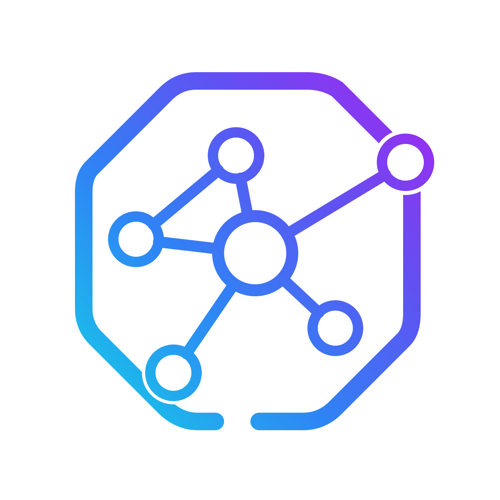

<p align="center">
  
</p>

<h1 align="center">Okto Grafx Server</h1>

<p align="center">
  Put an <a href="https://pypi.org/project/okto-grafx/">Okto Grafx</a> embedded graph store on the
  network — REST for reads, a WebSocket session for writes, MCP for agents, an operator console, and a
  SQLite control plane that decides per store and per key what any of them may do.
</p>

<p align="center">
  <code>python ≥ 3.11</code> · <code>okto-grafx 0.0.8</code> · 37 documented HTTP paths ·
  OpenAPI 3.1 · Elastic License 2.0 + Okto addendum
</p>

<p align="center">
  <a href="https://github.com/OktoLabsAI/okto-grafx-server/actions/workflows/ci.yml">
    
  </a>
</p>

---

**Install with one command** — macOS and Linux, no root, and `--dry-run` shows every step before it takes
one:

```bash
curl -fsSL https://raw.githubusercontent.com/OktoLabsAI/okto-grafx-server/v0.2.0/install.sh | bash
```

It puts `oktografx-server` in `~/.local/bin`, creates a state directory, and starts the daemon on
<http://127.0.0.1:8737/>, which answers as soon as it is up: no token, nothing to copy, because the
administrator surface is open to this machine and closed to everywhere else. No `pip install`, no Node, no
service manager. Flags go after `bash -s --`; the checksum, the uninstaller and installing from source are
in [Install](#install).

The store stays embedded and on local disk. This server holds it open on your behalf; it does not copy
it, cache it, or move it. **A local process with filesystem access can open the same store directly and
bypass every rule below: this is logical access control, not an OS sandbox.**

There is no SDK. Everything is plain HTTP, WebSocket and JSON-RPC, documented by the OpenAPI file the
server serves itself.

### Contents

1. [What it is, what it is not](#what-it-is-what-it-is-not)
2. [Capabilities](#capabilities)
3. [Requirements](#requirements)
4. [Install](#install)
5. [Quickstart](#quickstart)
6. [Using the operator console](#using-the-operator-console)
7. [Connecting to the server](#connecting-to-the-server) — every surface, one section each
   · [REST data plane](#rest-data-plane)
   · [WebSocket write session](#websocket-write-session)
   · [MCP for agents](#mcp-for-agents)
   · [Admin API](#admin-api)
   · [CLI](#cli)
   · [Health, metrics, OpenAPI](#health-metrics-openapi)
8. [Writes and the two toggles](#writes-and-the-two-toggles)
9. [Maintenance, DDL and jobs](#maintenance-ddl-and-jobs)
10. [Errors](#errors)
11. [Configuration reference](#configuration-reference)
12. [Limits and budgets](#limits-and-budgets)
13. [Security notes](#security-notes)
14. [Logs](#logs)
15. [Running as a service](#running-as-a-service)
16. [Operator recipes](#operator-recipes)
17. [Visual identity](#visual-identity)
18. [Development](#development)
19. [Repository layout](#repository-layout)
20. [License and branding](#license-and-branding)

---

## What it is, what it is not

**It is** a server for stores you already have. Point it at a directory containing an Okto Grafx store;
it registers that path, opens handles on demand, and answers queries, searches and graph captures
against the live files. Attachments are by reference: nothing is imported, copied or converted.

**It is** an admission layer. Every request is resolved to a store registration and an API key, and both
have to permit what was asked. Read-only stores, read-only keys and write sessions are three separate
doors, and a refusal says which one closed.

**It is not** a hosted database, a sync engine, or a replica set. There is one writer per store, granted
by the engine as a lease; the server queues behind it rather than pretending to share it.

**It is not** an analytics cache or an ORM. It returns what the engine returned, with the engine's
statistics, on a stated snapshot — including when that answer is a refusal.

## Capabilities

| | |
| --- | --- |
| **Query** | Cypher over HTTP with parameters, row caps, budgets, EXPLAIN without execution, and the engine's own statistics per answer. |
| **Search** | Full-text (boolean, prefix, phrase), vector (exact or ANN, with the regime reported), and hybrid RRF fusion. The server never generates an embedding and never runs an analyzer implicitly. |
| **Graph** | Projection captures by table, statement captures by query, one-hop expansion by physical id. Loops and parallel edges survive; an over-budget capture refuses instead of truncating. |
| **Write** | Only over a WebSocket session in `mode=write`, only when the store's two toggles **and** the key's toggle are all on. `commit_ok` means durable. |
| **Schema & DDL** | Full catalog including stored types; up to 64 DDL statements in one write transaction; the one-way identity-index door. |
| **Maintenance** | `verify`, `bloat`, `status`, `checkpoint`, `recover`, `rebuild_index`, `rebuild_vector_index`, `rehash_index`, `vacuum`, `cleanup_indexes` — as jobs, one per store, with quiescence and confirmation rules read from the library at runtime. |
| **Agents** | MCP over Streamable HTTP with ten tools. `write` is absent from `tools/list` unless the key allows writes, and still needs `confirm_write: true`. |
| **Operations** | Operator console, per-store handle and budget reporting, job queue, audit trail, Prometheus/OpenMetrics exposition, rotating structured logs, request ids on every response. |
| **Control plane** | SQLite: registrations, keys, sessions, jobs, audit. Secrets are stored as hashes only. |

## Requirements

* **Python 3.11+** (the engine builds and opens stores natively; no JVM, no server process besides this one).
* **`okto-grafx`** — the embedded library, installed automatically as a dependency.
* **Node 20.19+ or 22.12+** *only* if you want to rebuild the operator console from source (`web/`
  declares those engines; CI builds on 22). The built console is in
  this repository, so the daemon can serve `/` right after install.
* **Stores** — directories created by `oktografx create` or by `oktografx-python`. The server never
  creates a store; it attaches to ones that exist.
* A filesystem that supports the engine's durability requirements, and one process holding a given
  store's writer lease.
* **`curl`** and a POSIX shell, for the one-command installer. It works on the bash macOS ships (3.2),
  which is what `curl … | bash` runs there.

## Install

### With one command

```bash
curl -fsSL https://raw.githubusercontent.com/OktoLabsAI/okto-grafx-server/v0.2.0/install.sh | bash
```

It puts `oktografx-server` in `~/.local/bin` — with `uv tool install` when `uv` is present, otherwise in a
venv under `~/.local/share` — creates the state directory, starts the daemon on `127.0.0.1:8737`, waits
until `/api/v1/health` answers, and then says what opened: **nothing is required to reach it from this
machine**. Open <http://127.0.0.1:8737/> — no token to copy, no sign-in step, nothing to lose.

A token is opt-in, because a credential you did not choose is a credential you will lose:

```bash
curl -fsSL https://raw.githubusercontent.com/OktoLabsAI/okto-grafx-server/v0.2.0/install.sh \
  | bash -s -- --with-admin-token
```

That mints one, prints it once, keeps a copy at `~/.local/state/okto-grafx-server/admin-token` (mode
`0600`), and from then on every administrator request has to carry it — from the console, from the CLI, from
anywhere. [Settings](#the-console) shows the same switch and the commands that go with it.

Flags go after `bash -s --`. `--dry-run` prints every command and changes nothing, which is a reasonable
thing to ask of anything you pipe into a shell:

```bash
curl -fsSL https://raw.githubusercontent.com/OktoLabsAI/okto-grafx-server/v0.2.0/install.sh \
  | bash -s -- --port 8899 --root ~/graphs --dry-run
```

| flag | default | what it decides |
| --- | --- | --- |
| `--prefix DIR` | `~/.local` | where the `oktografx-server` command goes |
| `--state-dir DIR` | `~/.local/state/okto-grafx-server` | `server.toml`, `server.db`, the token file |
| `--root DIR` | `~/graphs` | the only directory `db add` may read stores from; created if missing |
| `--port N` | `8737` | loopback port |
| `--installer auto\|uv\|pip` | `auto` | which installer to use (`uv` is preferred when present) |
| `--python PATH` | first 3.11+ on PATH | interpreter for the venv (uv supplies its own) |
| `--wheel FILE`, `--from-tree DIR` | — | install a local artifact instead of the release |
| `--with-admin-token` | off | require an administrator token: mints one, prints it once, writes the `0600` copy |
| `--no-init`, `--no-run` | off | install the command only, do not start the daemon |
| `--no-token-file` | off | with `--with-admin-token`, print the token instead of also writing it to the state directory |

The same choices are environment variables, which is how CI and an air-gapped machine drive it without
flags: `OKG_PREFIX`, `OKG_GRAPH_ROOT`, `OKG_PORT`, `OKTO_GRAFX_SERVER_STATE`, `XDG_DATA_HOME` and
`XDG_STATE_HOME`, plus `OKG_BASE_URL` to fetch the wheel and its `SHA256SUMS` from a mirror — or a
`file://` directory — instead of the GitHub release. `install.sh --help` lists them.

Two behaviours are deliberate:

* **A rerun never re-initialises.** Running `init` again would mint a new administrator token over the
  one you are holding, so the installer stops when `<state>/server.toml` exists and points at
  `oktografx-server admin-token rotate` for when that is what you meant. The control plane stores hashes,
  so rotation is the only recovery from a lost token — and while no token has ever been configured, there
  is nothing to lose.
* **The checksum proves transport, not authenticity.** The wheel is fetched from the GitHub release for
  this version and its SHA-256 is compared against that release's `SHA256SUMS`. That catches a truncated
  or substituted download. It does not prove the release is genuine, since both files come from the same
  place — so pin the URL to a tag, as above, rather than to `latest`, and if that distinction matters in
  your threat model, download both files, check them yourself, and run the script from disk:

```bash
curl -fsSLO https://github.com/OktoLabsAI/okto-grafx-server/releases/download/v0.2.0/SHA256SUMS
sha256sum -c --ignore-missing SHA256SUMS        # macOS: shasum -a 256 -c --ignore-missing SHA256SUMS
bash install.sh --root ~/graphs
```

The daemon listens on loopback over plain HTTP: anything else on this machine can reach the port, and —
while no token is configured — whatever reaches it is the administrator. Anything on this machine with
filesystem access can open the same store directly either way. The daemon the installer starts is a `nohup`
background process, not a supervised service — for launchd or systemd, see
[Running as a service](#running-as-a-service).

To take it back out:

```bash
curl -fsSL https://raw.githubusercontent.com/OktoLabsAI/okto-grafx-server/v0.2.0/uninstall.sh | bash
```

That removes the command and the environment it lives in and stops the daemon belonging to that state
directory. It leaves `server.toml`, `server.db`, the audit trail and the token where they are — a
registration is a reference to a store that lives wherever you put it, and an uninstall should not rewrite
that. `--purge-state` removes the control plane deliberately, and still never deletes a store.

The package is not on PyPI yet, so `pip install okto-grafx-server` does not work today; this release and
the source below are the two ways in.

### From this repository

```bash
git clone https://github.com/OktoLabsAI/okto-grafx-server.git
cd okto-grafx-server
python3.11 -m venv .venv
.venv/bin/pip install -e .                  # the daemon: oktografx-server
```

With uv, which is what the maintainers use (note: a uv venv has no `pip` inside it):

```bash
uv venv --python 3.11
uv pip install -e . --python .venv/bin/python
```

Development extras (`pytest`, `httpx`, `psutil`, `ruff`) come from `.[dev]`:

```bash
.venv/bin/pip install -e '.[dev]'
```

### The console

`src/okto_grafx_server/web/` is committed, so `/` already works after the install above. To rebuild it
from source — required if you change anything under `web/`:

```bash
cd web && npm ci && npm run build && cd ..    # writes into ../src/okto_grafx_server/web/
```

Skip it and every JSON, WebSocket and MCP surface still works; only the browser console is empty.

### Verify the install

```bash
.venv/bin/oktografx-server --version          # oktografx-server 0.2.0
.venv/bin/oktografx-server init --help
```

## Quickstart

### 1. Create the state directory

```bash
.venv/bin/oktografx-server init --root ~/graphs --port 8737
```

```
state directory: /Users/you/.local/state/okto-grafx-server
configuration:   …/server.toml
control database:…/server.db
console:         http://127.0.0.1:8737/

administrator:   no token required — the console answers this machine only, and anything
                 arriving from somewhere else is refused.
                 require one later: oktografx-server --state-dir … admin-token rotate
```

No credential is created, because none is required: there is nothing to print, nothing to lose, and no
step between installing and looking at your stores. The boundary is the machine.

Add `--with-admin-token` to `init` and it is a different server: a token is minted, printed once, kept
only as a hash, and demanded on every administrator request. `admin-token status` says which of the two
you are running, `rotate` replaces the value and signs out every browser holding the old one, `clear`
removes the requirement again. Settings has the same three moves and shows the new value once.

The value printed below is a placeholder — a real token is 32 url-safe characters after `okga_`.

### 2. Run the daemon

```bash
.venv/bin/oktografx-server run --port 8737
```

### 3. Attach a store

Either in the console (`Add existing store` → pick a directory the daemon found → `inspect` →
`attach store`), or from the CLI:

```bash
.venv/bin/oktografx-server db add ~/graphs/docs --slug docs
.venv/bin/oktografx-server status
```

A store is only accepted inside `allowed_roots` (`--root` above). Attaching is by reference: the
registration holds the path and the store's own physical UUID, and `inspect` shows what the store says
it is — format version, page size, file count — before anything is registered.

### 4. Read it

```bash
BASE=http://127.0.0.1:8737

# The control plane, from this machine. With no token configured — the default — a plain request
# from loopback *is* the administrator, and there is nothing to exchange first.
curl -sS "$BASE/admin/api/session"
# {"signed_in":true,"token_configured":false,"auth":"open-loopback",…}

# If you turned a token on, exchange it for a session cookie and pass that cookie below:
curl -sS -c cookies.txt -X POST "$BASE/admin/api/login" \
  -H 'content-type: application/json' -d '{"token":"okga_…"}'
# {"signed_in":true,"expires_in_seconds":43200}

# A data-plane key, scoped to one store, read-only. The secret is returned once.
KEY=$(curl -sS -X POST "$BASE/admin/api/keys" \
  -H 'content-type: application/json' \
  -d '{"name":"reporting","databases":["docs"],"allow_writes":false}' | jq -r .key)
```

Every control-plane call from this machine works like that last one — no cookie — for as long as no token
is configured. Turn one on and each call needs `-b cookies.txt` from the login above; the examples below
skip it.

curl -sS -H "Authorization: Bearer $KEY" "$BASE/api/v1/databases/docs/schema"
curl -sS -X POST -H "Authorization: Bearer $KEY" -H 'content-type: application/json' \
  "$BASE/api/v1/databases/docs/query" \
  -d '{"query":"MATCH (d:Doc)-[r:CITES]->(o:Doc) RETURN d, r, o ORDER BY d.id LIMIT 5","limit":50}'
```

### 5. The one thing that surprises everyone

A **brand-new store cannot be opened read-only**: a read-only open can only prove consistency of a
database whose WAL is already checkpoint-complete. The refusal says exactly that
(`unsupported_operation`, `field: read_only_consistency`) and names the remedy, which is three clicks
in the console or three calls:

```bash
curl -sS -X PATCH "$BASE/admin/api/databases/docs" \
  -H 'content-type: application/json' -d '{"read_only":false,"allow_writes":true}'
curl -sS -X POST "$BASE/admin/api/databases/docs/actions/recover"    -H 'content-type: application/json' -d '{"arguments":{}}'
curl -sS -X POST "$BASE/admin/api/databases/docs/actions/checkpoint" -H 'content-type: application/json' -d '{"arguments":{}}'
curl -sS -X PATCH "$BASE/admin/api/databases/docs" \
  -H 'content-type: application/json' -d '{"read_only":true,"allow_writes":false}'
```

After that, every read is served through a read-only handle, and writes stay refused.

## Using the operator console

`http://127.0.0.1:8737/` — opens on your stores. There is no sign-in screen while no token is required;
if one is, the session is an **httpOnly, SameSite=Strict cookie** valid 12 h and the token is never kept
in the page. Settings → *administrator* is where that switches either way.

| Screen | What it is for |
| --- | --- |
| **Databases** | The registrations, their door (`read-only` / `writable`), physical UUID, and open/eject/close/remove. `Add existing store` inspects a directory before registering it. |
| **Store detail** | Schema with stored types, index inventory, health, the Maintenance tab (job cards with their arguments), DDL, and the registration form. |
| **Query console** | CodeMirror with completion, `EXPLAIN`, row cap, statistics, statement history kept in *your browser only*, and `view as graph`. |
| **Graph** | Sigma.js capture — projection or statement — with node/edge filters, weight column, layout choice, click-to-inspect for **nodes and relationships**, expand-neighbourhood, JSON and PNG export. |
| **Search** | Full-text / vector / hybrid tabs. The index picker lists only the indexes that can answer the regime you picked, and the vector tab says out loud that the server does not generate embeddings. |
| **API keys** | Mint scoped keys (the secret appears once), enable/disable, revoke, and "use here" to make the console query as that key — so what you see is what that credential can see. |
| **Jobs** | Maintenance jobs, their state, progress and errors. |
| **Audit** | Who did what: actor, action, store, status, duration, request id. Filterable by action. |
| **Settings** | The effective configuration, the limits, the security posture (TLS, CORS, metrics, consent flags), the administrator switch — require a token, rotate it, stop requiring one — with the command-line equivalents, and the maintenance catalog. |

Three behaviours are deliberate:

* **Read-only by default.** A fresh registration is read-only, because that is the safe first look at
  somebody else's store.
* **Nothing destructive is one click deep.** Anything that opens a door, mints or revokes a credential,
  ejects/removes, or runs maintenance asks for confirmation and says what changes.
* **The console never invents a shape.** Every field comes from the daemon's own payload; the attach
  form is generated from the option table the installed library reports.

### Reading the graph

The canvas draws the capture the daemon returned — nothing else. Node radius is degree; a self-loop and
parallel relationships are kept as drawn, because collapsing them would hide a real distinction in the
store.

* **Click a node or a relationship to inspect it** — the label counts as the thing it belongs to, so the
  text is clickable too. The background clears the selection.
* An inspected node shows its table, `record_id`, properties (or says that a projection carries none) and
  its relationships, each clickable. An inspected relationship says which way it points — `Task:4 is the
  source, Module:2 the target` — because a stroke carries no arrowhead, and both endpoints are buttons.
* **Hovering resolves one neighbourhood**: relationships that do not touch the focused node disappear
  while the cursor rests there, and stay merely faded once you have clicked. Node and edge labels are
  forced visible wherever the focus touches.
* Double-click centres on a node; dragging a node writes its position back, so an arrangement you made
  survives a repaint and an export.
* Zoom, fit and *re-run layout* are on the canvas; the layout is ForceAtlas2 run in bounded chunks, and
  the camera re-fits once the graph has stopped moving rather than while it flies.
* No WebGL (locked-down VM, GPU disabled, headless test runner)? The capture is **listed instead of
  drawn** — the same node and relationship inspection, no canvas.

Legibility here is measured, not assumed: strokes never draw thinner than 2.2 px on the `#06070b`
ground, labels sit on their own plates, and the contrast floors are asserted in
`web/src/lib/graph-view.test.ts`, so a palette change that makes the graph unreadable fails a test
instead of a screenshot.

Deep links: `?mode=query&query=…` draws a statement on arrival (that is what *view as graph* sends), and
`?focus=Table:7` opens the neighbourhood of one record and selects it.

## Connecting to the server

Six surfaces, two doors, three kinds of credential. Pick the one that matches the work:

| Surface | Transport | Credential | Use for |
| --- | --- | --- | --- |
| [REST data plane](#rest-data-plane) | HTTPS-less HTTP/1.1, JSON | `Authorization: Bearer okg_…` | applications reading, searching, capturing graphs |
| [WebSocket session](#websocket-write-session) | `GET /api/v1/ws` upgrade, JSON frames | bearer in `?token=`, `bearer.<token>` subprotocol, or header | **writes**, long read transactions, streaming batches |
| [MCP](#mcp-for-agents) | `POST /mcp`, JSON-RPC 2.0 | `Authorization: Bearer okg_…` | agents and tools that speak Model Context Protocol |
| [Admin API](#admin-api) | HTTP, JSON | nothing from this machine by default; token → `okg_session` cookie once one is configured | registrations, keys, maintenance, DDL, audit, settings |
| [Operator console](#using-the-operator-console) | browser on the admin API + data plane | same cookie, optional pasted key | humans |
| [CLI](#cli) | local, direct on the state directory | filesystem access to the state dir | bootstrapping, cron, emergencies |

**The two doors are not interchangeable in one direction.** A data-plane key on `/admin/api` is refused
with `admin_session_required`; the administrator — cookie, token header, or the loopback default — is
accepted on both doors, which is how the console queries stores without you pasting a key into it.
Two surfaces are unauthenticated by design and carry no store facts: `GET /api/v1/health` and
`GET /metrics` (the latter disabled unless you enable it).

| | Data plane `/api/v1` + `/mcp` + `/api/v1/ws` | Admin plane `/admin/api` |
| --- | --- | --- |
| Credential | `Authorization: Bearer okg_…` (API key) | none, from this machine, until a token is configured; then token → `okg_session` cookie (httpOnly, SameSite=Strict, 12 h) |
| Scope | the stores the key lists, read or read-write | everything, including store rows |
| Lifetime | until revoked or deleted | sessions: 12 h, or until `logout` / token rotation. Open access ends when you require a token |
| Stored as | hash only | hash only |

Every response carries `X-Request-Id`; the same id appears in error envelopes and in `server.log`, so a
screenshot is enough to find the line.

### REST data plane

Base: `/api/v1`. All bodies and answers are JSON. Reads open their own snapshot; there is no cursor and
no session.

| Method | Path | Notes |
| --- | --- | --- |
| GET | `/api/v1/health` | unauthenticated liveness + counts; no store facts |
| GET | `/api/v1/databases` | the stores *this key* can see |
| GET | `/api/v1/databases/{slug}/schema` | tables, relationship tables, columns with stored types |
| GET | `/api/v1/databases/{slug}/indexes` | index inventory, staleness, what is searchable |
| POST | `/api/v1/databases/{slug}/query` | `{"query","parameters","limit","mode","budget"}` |
| GET | `/api/v1/databases/{slug}/explain?query=…` | operator tree, no execution |
| POST | `/api/v1/databases/{slug}/search/text` | `{"index","query","k","prefix","phrase","record_ids"}` |
| POST | `/api/v1/databases/{slug}/search/vector` | `{"space","vector","table","k","record_ids"}` |
| POST | `/api/v1/databases/{slug}/search/hybrid` | `{"table","index","query","space","vector","k","record_ids"}` |
| POST | `/api/v1/databases/{slug}/graph` | `{"mode":"projection"\|"query", …}` |
| GET | `/api/v1/databases/{slug}/neighbors?table=&record_id=&limit=` | one hop by physical id |

```bash
curl -sS "$BASE/api/v1/health"
# {"status":"ok","server":"0.2.0","grafx":"0.0.8","databases_registered":1,"databases_open":1,
#  "uptime_seconds":12.4,"runner":{"submitted":3,"completed":3,"failed":0,"cancelled_waiters":0,"in_flight":0}}

curl -sS -H "Authorization: Bearer $KEY" "$BASE/api/v1/databases"
curl -sS -H "Authorization: Bearer $KEY" "$BASE/api/v1/databases/docs/schema"
curl -sS -H "Authorization: Bearer $KEY" "$BASE/api/v1/databases/docs/indexes"
```

#### Query

```bash
curl -sS -X POST -H "Authorization: Bearer $KEY" -H 'content-type: application/json' \
  "$BASE/api/v1/databases/docs/query" \
  -d '{"query":"MATCH (d:Doc)-[r:CITES]->(o:Doc) RETURN d, r, o ORDER BY d.id LIMIT 5","limit":50}'
```

```json
{"columns":["d","r","o"],
 "rows":[[{"kind":"node","id":"Doc:1","table":"Doc","record_id":1,"label":"Doc",
           "labels":["Doc"],"properties":{"title":"durable wal","…":1}},
          {"kind":"relationship","id":"CITES:1","table":"CITES","label":"CITES",
           "start":"Doc:1","end":"Doc:2","properties":{"weight":1.0}},
          {"kind":"node","id":"Doc:2","…":{}}]],
 "row_count":5,"truncated":false,"statistics":{"…":1},"warnings":[],
 "duration_ms":5.21,"snapshot_lsn":41}
```

The body is `query`, `parameters`, `limit`, `timeout_seconds` (≤ 600) and `explain`. With `explain: true`
the answer carries `plan` next to the rows; `GET …/explain` is the same operator tree on its own. Values
longer than `max_query_value_characters` are truncated and say so in `warnings`.

Two rules hold across the whole data plane. **There is no cursor:** every request opens its own read
transaction on a fresh snapshot, so "page 2" is a different database than page 1 unless you widen the
statement — the `snapshot_lsn` in each answer is how you tell. And **no value is flattened silently**:
decimals keep precision and scale, temporal values keep their kind, vectors are tagged objects rather
than plain lists, and a value that had to be degraded says so in `warnings`.

Entities come back as **physical ids** (`table:record_id`), never as application keys.

#### Search

```bash
curl -sS -X POST -H "Authorization: Bearer $KEY" -H 'content-type: application/json' \
  "$BASE/api/v1/databases/docs/search/text" \
  -d '{"index":"doc_text","query":"vector AND storage","k":5,"prefix":false,"phrase":false}'
# {"hits":[{"table":"Doc","record_id":1,"id":"Doc:1","score":1.1374,
#           "matched_fields":["title"],"matched_terms":["vector"],"positions":[]}],
#  "regime":"exact_index","candidates":1,"postings_visited":36,"corpus_documents":4,
#  "index_built_through_commit":38,"snapshot_commit":41,"statistics_regime":"full_census","table":"Doc"}

curl -sS -X POST -H "Authorization: Bearer $KEY" -H 'content-type: application/json' \
  "$BASE/api/v1/databases/docs/search/vector" \
  -d '{"space":"semantic","vector":[1,0],"table":"Doc","k":3}'
# hits carry score + regime ("exact" for a full scan, "approximate" when the ANN index answered)

curl -sS -X POST -H "Authorization: Bearer $KEY" -H 'content-type: application/json' \
  "$BASE/api/v1/databases/docs/search/hybrid" \
  -d '{"table":"Doc","index":"doc_text","query":"durable","space":"semantic","vector":[1,0],"k":3}'
# hits carry lexical_rank/vector_rank/score from the RRF fusion, and the payload says which sources ran
```

You supply the vector and the index name. `record_ids` narrows a search to a set of physical record ids
— the filter the engine actually supports; anything looser belongs in the `WHERE` of a Cypher statement,
where it is visible in the query rather than hidden in a knob.

The answers are honest about how they were produced: `regime` tells you whether an exact scan or an ANN
index answered, and `candidates` / `postings_visited` / `statistics_regime` tell you how much of the
corpus the engine actually looked at.

#### Graph

```bash
curl -sS -X POST -H "Authorization: Bearer $KEY" -H 'content-type: application/json' \
  "$BASE/api/v1/databases/docs/graph" \
  -d '{"mode":"projection","node_tables":["Doc","Tag"],"relationship_tables":["CITES"],
       "weight_columns":{"CITES":"weight"},"max_nodes":500,"max_edges":1500}'
# {"nodes":[…],"edges":[…],"shown_nodes":9,"total_nodes":9,"shown_edges":12,"total_edges":12,
#  "truncated":false,"snapshot_lsn":41,"database_uuid":"8db96c…","mode":"projection","warnings":[]}

curl -sS -H "Authorization: Bearer $KEY" "$BASE/api/v1/databases/docs/neighbors?table=Doc&record_id=1&limit=200"
```

`mode` is `projection` (the default, built from `node_tables` and `relationship_tables`) or `query`,
which draws what a statement returns and so takes `query` and `parameters` instead of tables. It is a
different request from `POST …/query`, which answers rows and knows nothing about captures.

Both endpoints of a selected relationship must be selected as well, and `weight_columns` must name a
property for **every** selected relationship table — a partial map is refused with
`configuration_error` rather than drawn on two unstated scales. There is no `depth` knob: query mode
draws what a statement returns, so depth is written where it is readable —
`MATCH (a)-[:CITES*1..3]->(b)`. One-hop expansion by physical id is `GET …/neighbors`, which is what the
console's "expand neighbourhood" button calls.

### WebSocket write session

`GET /api/v1/ws` (upgrade). Browsers cannot set headers on a handshake, so pass the key as `?token=…` or
as the `bearer.<token>` subprotocol; native clients can use the `Authorization` header.

The whole session is one transaction at a time:

| you send | the server answers |
| --- | --- |
| `{"type":"hello","db":"docs","mode":"write"}` | `hello_ok` (or an error frame, then close) |
| `{"type":"begin","mode":"write","id":1}` | `begin_ok` |
| `{"type":"execute","id":2,"query":"…","parameters":{}}` | `batch` (0..n) … `batch_end` |
| `{"type":"commit","id":3}` | `commit_ok` — durable by the time it arrives |
| `{"type":"rollback","id":n}` / `{"type":"close_tx"}` | `rollback_ok` / `close_tx_ok` |
| `{"type":"cancel"}` | `cancel_ack` (read transactions only; writes say `cancellation_unavailable`) |
| `{"type":"ping"}` | `pong` |

```js
const socket = new WebSocket(`ws://127.0.0.1:8737/api/v1/ws?token=${key}`);
const send = (m) => socket.send(JSON.stringify(m));
socket.addEventListener("open", () => send({ type: "hello", db: "docs", mode: "write" }));
socket.addEventListener("message", (event) => {
  const frame = JSON.parse(event.data);
  if (frame.type === "hello_ok") send({ type: "begin", mode: "write", id: 1 });
  if (frame.type === "begin_ok")
    send({ type: "execute", id: 2, query: "CREATE (:Doc {id: $id, title: $t})",
           parameters: { id: 9001, t: "written over the socket" } });
  if (frame.type === "batch_end") send({ type: "commit", id: 3 });
  if (frame.type === "commit_ok") socket.close();
  if (frame.type === "error") { console.error(frame.code, frame.message); socket.close(); }
});
```

`mode:"read"` works the same way and is the way to hold one snapshot across several statements.

Frames you will also see: `idle_timeout` (after `idle_session_ttl_seconds`), `error`
(`no_transaction`, `transaction_open`, `unknown_message`, `malformed_message`, `write_not_permitted`,
`write_lane_busy`, `too_many_sessions`), and `closed`. Statements are capped at `max_ws_batches`
batches. Writes are audited: the trail records the statement (truncated to 400 characters) and the
*shape* of each parameter (`str<32>`), never its values.

### MCP for agents

`POST /mcp` — JSON-RPC 2.0 over Streamable HTTP, authenticated with the same API key. It is stateless:
no session id, so any agent that can POST can use it. `GET /mcp` answers `405` with a JSON explanation
(`"This MCP endpoint is Streamable HTTP: send JSON-RPC POSTs to /mcp."`) and the server's protocol version
— there is no SSE stream to subscribe to.

```bash
curl -sS -X POST "$BASE/mcp" -H "Authorization: Bearer $KEY" -H 'content-type: application/json' \
  -d '{"jsonrpc":"2.0","id":1,"method":"initialize",
       "params":{"protocolVersion":"2024-11-05","capabilities":{},
                 "clientInfo":{"name":"curl","version":"1"}}}'

curl -sS -X POST "$BASE/mcp" -H "Authorization: Bearer $KEY" -H 'content-type: application/json' \
  -d '{"jsonrpc":"2.0","id":2,"method":"tools/list"}'

curl -sS -X POST "$BASE/mcp" -H "Authorization: Bearer $KEY" -H 'content-type: application/json' \
  -d '{"jsonrpc":"2.0","id":3,"method":"tools/call",
       "params":{"name":"query","arguments":{"db":"docs",
                 "cypher":"MATCH (d:Doc) RETURN d.id ORDER BY d.id LIMIT 5"}}}'
```

| tool | what it does |
| --- | --- |
| `list_databases` | the stores this key can see |
| `describe_schema` | tables, columns, relationship tables, indexes, spaces |
| `query` | `cypher` + `parameters` + `limit` |
| `explain` | operator tree |
| `search_text` / `search_vector` / `search_hybrid` | the same three regimes as REST |
| `graph_projection` / `graph_neighborhood` | captures, same budgets as REST |
| `write` | **only listed when the key has `allow_writes`**, and it needs `confirm_write: true` |

`write` requiring an explicit confirmation argument is deliberate: a model has to be told twice, in the
tool's own contract, before it can change a store. Every call is audited as `mcp.<tool>`. Note the data
plane field is called `query` while the MCP argument is called `cypher` — each surface is self-describing
through `tools/list` or OpenAPI.

For a client that expects a server entry:

```json
{ "mcpServers": { "okto-grafx": { "url": "http://127.0.0.1:8737/mcp",
  "headers": { "Authorization": "Bearer okg_…" } } } }
```

### Admin API

Base: `/admin/api`, answered through the session cookie. By default nothing has to be exchanged — a
request that arrives from this machine *is* the administrator, and everything else is refused. Once a
token is configured, get a cookie:

```bash
curl -sS -c cookies.txt -X POST "$BASE/admin/api/login" -H 'content-type: application/json' \
  -d '{"token":"okga_…"}'
```

| Method | Path | Notes |
| --- | --- | --- |
| POST | `/login` · `/logout` | token → cookie; only meaningful while a token is configured |
| GET | `/session` | `signed_in`, `token_configured`, `auth` (`token` or `open-loopback`), `server_version` |
| POST | `/admin-token` | require a token: mints one, shown once, and signs *this* browser in with it. `409` when one already exists — that is what rotate is for |
| POST | `/admin-token/rotate` | mints a new token; the old one and every session built on it die |
| DELETE | `/admin-token` | stop requiring one: back to this-machine-only, sessions and keys untouched |
| GET | `/settings` | effective config, limits, security posture, maintenance catalog, and the **`DatabaseConfig` option table** the attach form is built from |
| GET | `/status` | open handles, per-store buffer budget, quarantine flags, runner counters, ws sessions, uptime |
| GET | `/roots` | the candidate store directories the daemon found under `allowed_roots` |
| GET/POST | `/databases` | list registrations; register by reference |
| POST | `/databases/inspect` | read the store's own facts before registering it |
| GET/PATCH/DELETE | `/databases/{slug}` | the record; change `name`, `read_only`, `allow_writes`, `enabled`, `open_policy`, `note`, `options` — a new `options` map is re-validated against the library table, so a door opens only onto settings the engine actually supports |
| POST | `/databases/{slug}/open` · `/close` · `/eject` | handle control (`eject` forgets nothing, `close` drains) |
| POST | `/databases/{slug}/actions/{action}` | maintenance as a job: `202 {"job_id":…}`, body `{"arguments":{…}}` |
| POST | `/databases/{slug}/ddl` | up to 64 statements, one write transaction |
| GET | `/databases/{slug}/inventory` | indexes, staleness, recovery state |
| GET | `/schema/{slug}` | catalog with full stored types |
| POST | `/schema/{slug}/ddl` · `/schema/{slug}/identity-indexes` | DDL; the one-way identity-index door |
| GET/POST | `/keys` | list (never secrets); mint — the secret is in the create response only |
| PATCH/DELETE | `/keys/{key_id}` | enable/disable; delete (refuse while live) |
| POST | `/keys/{key_id}/revoke` | immediate |
| GET | `/jobs` · `/jobs/{job_id}` | the maintenance queue and one job |
| GET | `/audit` | the trail; `?actor=`, `?database=`, `?action=`, `?limit=` |

`PATCH /admin/api/databases/docs` is the only way to open a door, and `allow_remote_store_metrics`
(see [Security notes](#security-notes)) is refused unless you say you meant it.

### CLI

Everything the console does, without a browser or a socket — useful for bootstrapping, cron jobs, and
the case where you have lost the admin token.

```
oktografx-server [--state-dir DIR] [--log-level LEVEL] [--version] <verb>
```

| Command | What it does |
| --- | --- |
| `init [--root DIR] [--port N] [--with-admin-token]` | Create the state directory and write `server.toml`. Mints no credential unless `--with-admin-token` says to; re-running keeps `server.toml` and every registration and says so rather than starting over. |
| `run [--host H] [--port N] [--i-understand-remote-binding] [--i-understand-remote-store-metrics]` | Run the daemon in the foreground. |
| `status` / `config` | Registered stores; the effective configuration as JSON. |
| `db add PATH --slug S [--name N] [--read-only\|--writable] [--allow-writes] [--open-policy lazy\|pinned] [--option K=V] [--i-understand-remote-store-metrics]` | Attach an existing store **by reference**. |
| `db list` / `db remove SLUG` | List; forget a registration (files are untouched). |
| `key create NAME [--db S] [--db S2] [--allow-writes]` | Mint a data-plane key. |
| `key list` / `key revoke KEY_ID` | List (never secrets); revoke. |
| `admin-token rotate` | Require a token: mint one (shown once) and invalidate the old one and every session built on it. |
| `admin-token status` | Say whether a token is required here, and when the current one was rotated. |
| `admin-token clear` | Stop requiring one; the console goes back to answering this machine only. |

`--state-dir` selects a different state directory (default `~/.local/state/okto-grafx-server`). The CLI
touches the SQLite control plane directly, so it works even when the daemon is down — and it must not be
run against a state directory owned by a daemon on another machine.

### Health, metrics, OpenAPI

| Surface | What you get |
| --- | --- |
| `GET /api/v1/health` | unauthenticated: `status`, `server`, `grafx` versions, store counts, uptime, runner counters. No store facts. |
| `GET /metrics` | Prometheus text; send `Accept: application/openmetrics-text` for OpenMetrics 1.0.0 (`# UNIT`, closing `# EOF`). Every family declares its `# TYPE`, labelled per-store samples included. **Off unless `metrics_enabled = true`** — the endpoint has no authentication. |
| `GET /api/v1/openapi.json` | OpenAPI 3.1, 37 paths, both doors documented separately, the error envelope in the schema. |
| `GET /api-docs` | the interactive documentation of the same file. |
| `GET /` and any SPA route | the console, with deep-link fallback. Nothing sets `Cache-Control`: browsers revalidate by `ETag`, and a rebuild changes every hashed asset name, so a stale bundle cannot survive a reload. |

```bash
curl -sS "$BASE/api/v1/health" | jq
curl -sS -H 'Accept: application/openmetrics-text' "$BASE/metrics" | head
```

## Writes and the two toggles

Writes are deliberately unavailable on the request/response door. A `CREATE`, `MERGE`, `SET` or `DELETE`
on `POST …/query` answers `403 write_not_permitted` with `details.reason` naming the closed door
(`read_only_door`, `database_read_only`, `database_write_toggle_off`, `key_read_only`), and the message
names the door you need:

```
A write statement must go through a WebSocket session opened with mode='write' on a key and
database whose write toggles are both on.
```

Both toggles are real: the **database** needs `read_only = false` **and** `allow_writes = true`, and the
**key** needs `allow_writes = true`. Then, and only then, does `ws mode=write` open. A second concurrent
writer on the same store is `429 write_lane_busy` — the engine grants one writer lease per store, and the
server will not queue you invisibly behind it.

Writes are audited frame by frame (`ws.begin`, `ws.execute`, `ws.commit`, `ws.rollback`, `ws.close_tx`),
and a conflict comes back as `409 write_conflict` (retryable): the server never replays a write for you,
because recomputing on a fresh snapshot is your decision, not its guess.

## Maintenance, DDL and jobs

`POST /admin/api/databases/{slug}/actions/{action}` turns maintenance into a job (`202 {job_id}`, then
`GET /admin/api/jobs/{id}`), one active job per store — a second request is `409 job_active` rather than
an invisible queue. The catalog of actions, their arguments, and whether they need quiescence or
confirmation comes from the engine via `GET /admin/api/settings`, and the console renders it as cards:

| action | read-only ok | needs |
| --- | --- | --- |
| `verify`, `bloat`, `status` | yes | — |
| `checkpoint`, `recover`, `rebuild_index`, `rebuild_vector_index`, `rehash_index` | no | writable registration |
| `vacuum`, `cleanup_indexes` | no | writable registration **and** `confirm_quiescent: true` |

Maintenance that needs quiescence closes this store's handles first, runs in a dedicated handle, and
leaves the store closed — the console says so and reopens it on the next request. `unknown action`, a
missing argument and a missing confirmation are each refused with their own code
(`unknown_maintenance_action`, `maintenance_argument_required`, `maintenance_confirmation_required`).

`GET /admin/api/schema/{slug}` answers with the catalog including the full `stored_type` of every column;
`POST /admin/api/schema/{slug}/ddl` (or `POST /admin/api/databases/{slug}/ddl`) runs up to 64 statements
in one write transaction and echoes what it ran. Both are refused while the store is registered
read-only, and both are audited.

`POST /admin/api/schema/{slug}/identity-indexes` is the library's one-way catalog door
(`ensure_identity_indexes`): it publishes the exact access paths the endpoint identities need. Being a
write, it obeys the same admission rules and appears in the audit trail; repeating it after the
generations are active performs no durable write, and the answer separates `activated` from
`already_present` so the operator can see that.

## Errors

Every refusal — REST, WebSocket frames, MCP (`error.data`) — uses one envelope:

```json
{"error":{"code":"budget_exceeded",
          "message":"A graph capture of 4213 nodes would exceed the configured limit of 2000.",
          "retryable":false,
          "details":{"resource":"nodes","requested":4213,"limit":2000},
          "request_id":"a28543ecf0cf",
          "field":"budget.max_nodes",
          "grafx_code":"budget_exceeded"}}
```

`field` and `grafx_code` appear when they exist. Status and code are separate from retryability:
`retryable: true` means the same call may succeed unchanged (queue pressure, too many sessions), and
`false` means it will not until something you control changes. 429 answers also carry `Retry-After`.

### Codes you will meet

| status | code | meaning |
| --- | --- | --- |
| 400 | `invalid_request` | the body did not match the documented schema; `details.problems` names each field |
| 401 | `missing_api_key`, `malformed_api_key`, `unknown_api_key`, `revoked_api_key`, `bearer_scheme_required` | the data-plane credential is absent, misshapen, unknown or revoked |
| 401 | `admin_session_required`, `admin_session_expired`, `invalid_admin_token` | the admin door, and nothing else answers behind it |
| 403 | `write_not_permitted` | a write tried to come through a door that does not write — `details.reason` is `read_only_door`, `database_read_only`, `database_write_toggle_off` or `key_read_only` |
| 403 | `database_disabled` | the store is registered but switched off — said plainly to anyone whose key is scoped to it, because the key already names that store |
| 404 | `not_found` | nothing by that name — and the **same answer, byte for byte**, for a store the key cannot see, so the API never leaks existence |
| 409 | `job_active`, `database_closed`, `write_conflict`, `maintenance_requires_writable`, `maintenance_not_quiesced` | live state disagrees with the request: a job is running, the store is closed, a writer lease is held |
| 413 | `budget_exceeded`, `request_too_large` | a cap, with `details.requested` and `details.limit` wherever they exist |
| 422 | `invalid_options`, `unknown_database_options`, `invalid_slug`, `invalid_path`, `invalid_database_change`, `invalid_open_policy`, `unknown_maintenance_action`, `maintenance_argument_required`, `allowed_roots_required`, `database_path_taken`, `remote_binding_requires_consent`, `remote_metrics_requires_consent`, `remote_store_metrics_requires_consent` | typed validation, before anything is touched |
| 429 | `too_many_sessions`, `reader_lanes_busy`, `worker_queue_full`, `write_lane_busy` | backpressure — `retryable: true`: the same call may succeed unchanged |
| 503 | `shutting_down` | the daemon is draining |
| 503 | `recovery_required` | the store stopped being able to prove a consistent read, so its handle is **quarantined** — reads and writes are refused with `details.hint: run_recover_action`; the administrator's inventory keeps answering, because that panel is the remedy |
| 500 | `internal_error` | our bug; the `request_id` ties it to the log line |

### What the engine says

Errors raised inside `okto-grafx` keep their own name in `grafx_code` and get an HTTP status from the
mapping in `errors.py`, so an agent can act on the status and a specialist can still read the source:

| engine codes | status |
| --- | --- |
| `query_cancelled`, `query_deadline_exceeded` | 408, retryable |
| `buffer_budget_exceeded`, `query_budget_exceeded`, `transaction_budget_exceeded` | 413 as `budget_exceeded` |
| `write_conflict` (+ `snapshot_reclaimed`, `space_retired`, `history_expired`, `schema_version_mismatch`, …) | 409, retryable: reopen a snapshot and recompute — the server never replays a write |
| `parse_error`, `plan_error`, `query_error`, `unsupported_operation`, `index_error`, `vector_validation`, `embedding_space_mismatch`, `configuration_error` | 400 |
| `device_full` | 507 |
| `storage_error`, `ledger_error`, `quarantine_error` | 422 |
| `lease_stolen`, `lease_timeout`, `stale_epoch`, `recovery_required` | 503, retryable |
| `corruption_detected`, `recovery_refused`, `durability_barrier_failed` | 500 — and `durability_barrier_failed` adds `details.unknown_outcome: true`, because the honest answer is that the write's fate is unknown |

A read-only open of a store whose WAL is not checkpoint-complete arrives as 400
`unsupported_operation` with `field: read_only_consistency`, and its message is the remedy: clear
`read_only`, run `recover` and `checkpoint`, put it back.

WebSocket refusals carry the same envelope inside the frame (`{"type":"error","code":…}`) without an
HTTP status: `hello_required`, `no_transaction`, `transaction_open`, `invalid_mode`,
`unknown_message`, `malformed_message`, `write_not_permitted`, `write_lane_busy`,
`cancellation_unavailable`, `idle_timeout`.

## Configuration reference

`oktografx-server init` writes `<state-dir>/server.toml`; every key is optional except the roots you want
to serve. `oktografx-server config` prints the effective configuration as JSON, and `GET /admin/api/settings`
prints the same thing the console shows.

```toml
bind_host = "127.0.0.1"
bind_port = 8737

# The server only opens stores inside these directories.
allowed_roots = [
    "/Users/you/graphs",
]

max_open_handles = 4
readers_per_database = 2
max_write_sessions = 1
max_ws_sessions = 8
max_request_rows = 1000
max_graph_nodes = 2000
max_graph_edges = 5000
query_timeout_seconds = 30.0
reader_lane_timeout_seconds = 5.0
metrics_enabled = false
# A store's own OpenMetrics sink has no auth and no TLS either: database options that point it
# at another machine are refused while this stays false.
allow_remote_store_metrics = false
cors_origins = []
audit_retention_days = 30
```

* `metrics_enabled` defaults to off because the exposition endpoint has no authentication of its own.
* A `bind_host` other than loopback requires `--i-understand-remote-binding`: there is no TLS here.
* `max_write_sessions` is accepted between 1 and 4 and refused outside that range: the engine grants
  **one writer lease per store**, so a bigger number would only queue sessions behind a lease that
  cannot be shared.
* Memory works the other way round: `buffer_budget_bytes` is granted **per handle**, so the cost of
  warming stores is `buffer_budget_bytes × handles` — see [Limits and budgets](#limits-and-budgets).
* Per-store creation options (`page_size`, `wal_*`, `buffer_budget_bytes`, …) are set at attach time and
  validated against the table the installed library reports — an option the library adds appears in the
  console without a frontend release.
* [Limits and budgets](#limits-and-budgets) is the complete list of the rest — including
  `idle_session_ttl_seconds`, `handle_idle_ttl_seconds`, `max_request_bytes`, `max_ws_batches` and
  `max_query_value_characters`, which the sample above leaves out because you rarely touch them.
* `metrics_host` and `metrics_port` are accepted, and `metrics_host` is refused off loopback, but **nothing
  binds them today**: the exposition is served by the daemon itself on `/metrics`. Treat them as unwired,
  not as a way to move the endpoint somewhere else.

## Limits and budgets

| key | default | what it bounds |
| --- | --- | --- |
| `max_open_handles` | 4 | live store handles across the process |
| `readers_per_database` | 2 | concurrent readers per store |
| `max_write_sessions` | 1 | concurrent write sessions per store — **1 to 4**: the engine grants one writer lease per store |
| `max_ws_sessions` | 8 | live WebSocket sessions |
| `max_request_rows` | 1000 | rows a query response may carry (it truncates and reports `truncated: true`) |
| `max_graph_nodes` / `max_graph_edges` | 2000 / 5000 | a graph capture — **never silently**: an over-budget capture is `413 budget_exceeded` |
| `query_timeout_seconds` | 30 | one statement |
| `reader_lane_timeout_seconds` | 5 | how long a request waits for a reader lane before `429 reader_lane_timeout` |
| `idle_session_ttl_seconds` | 60 | an idle WebSocket session is closed with `idle_timeout` |
| `handle_idle_ttl_seconds` | 120 | an idle handle is closed and reopened on demand |
| `audit_retention_days` | 30 | audit rows kept |
| `max_query_value_characters` | 65536 | one returned value |
| `max_request_bytes` | 2097152 | one request body |
| `max_ws_batches` | 200 | response batches per statement |

Two bounds are enforced on the handle pool, and the tighter one wins. The first is the count
(`max_open_handles`). The second is memory: a store's handles are collectively allowed
`buffer_budget_bytes` each, so the pool's ceiling is `max_open_handles × 64 MiB` (the engine's own default
per-handle budget) and a store configured with a larger budget pushes **idle** stores out of the pool early
rather than quietly multiplying the daemon's resident set. A lane with work in flight is never an eviction
candidate, and a single store is always allowed to stay open — refusing to serve the only registered
database because its own budget is large would be a worse failure than the memory it costs.
`GET /admin/api/status` reports the budget each open store is holding.

## Security notes

* **Loopback only.** The server binds `127.0.0.1` and has no TLS. Binding elsewhere needs
  `--i-understand-remote-binding` and demands a reverse proxy in front — and a server bound off-loopback
  refuses every administrator request until a token exists, so the open door described below is never
  open to anything but this machine.
* **Administrator access is open by default, and closed to everyone but this machine.** No token means no
  credential, which is the honest default for a single-user server on a loopback socket. Three things
  have to hold before a request counts as the operator: the peer address is loopback, the `Host` header
  names loopback, and a request that *changes* something carries same-site evidence — `Sec-Fetch-Site`, or
  an `Origin`/`Referer` pointing at this machine. A WebSocket handshake counts as a change, because that
  is what it opens. The `Host` rule is what defeats DNS rebinding; the same-site rule is what stops a page
  you visited from POSTing into your local server, since a browser cannot read the answer to a cross-origin
  POST but can certainly send one. A client with no browser fingerprint — curl, the CLI, an MCP client —
  is already on the machine, which is the boundary being drawn. Turning a token on (Settings →
  administrator, or `admin-token rotate`) puts a credential in front of all of it again, and a configured
  token is always demanded. There is deliberately no `server.toml` switch for this: the requirement
  follows whether a token exists, so the console, the CLI and a config file cannot disagree.
* **Credentials are hashes.** The admin token and API keys are stored as hashes; a database dump does not
  hand over usable secrets. Rotation and revocation are immediate.
* **The admin session is an httpOnly, SameSite=Strict cookie** — the token is never kept in the page, and
  cross-site requests cannot carry it. While a token is configured, that cookie or the token header is the
  only way in.
* **The audit trail is metadata only.** Statements are truncated to 400 characters and parameters are
  recorded as shapes (`str<12>`, `int`, `list<4>`), never values. It covers REST, the console, MCP and
  every write-session frame (`ws.begin`, `ws.execute`, `ws.commit`, `ws.rollback`, `ws.close_tx`).
* **Metrics are off by default** because `/metrics` has no authentication; if you enable it, keep it
  loopback or proxy it. The same reasoning covers a store's **own** metrics: database options that point
  the library's OpenMetrics sink at another machine (`metrics = "openmetrics"` with a remote
  `metrics_destination`, or `allow_remote_metrics = true`) are refused with
  `422 remote_store_metrics_requires_consent` until `allow_remote_store_metrics = true` (or
  `--i-understand-remote-store-metrics`) says you meant it — and the library then still requires its own
  `allow_remote_metrics = true`, so it takes two deliberate acts to ship store metrics anywhere. A
  loopback destination and the `json` file sink are always fine.
* **`allowed_roots` is the store boundary.** Paths are resolved and symlink components refused; a
  registration outside a root cannot be created, and an existing one that escapes after a config edit is
  refused at open time.
* **A store that needs recovery is quarantined.** The moment a handle reports `recovery_required`, the
  pool closes it and refuses to reopen one: reads and writes answer `503 recovery_required` instead of
  serving rows that the store can no longer prove consistent. The administrator's inventory keeps working
  — it is how you reach the `recover` action — and running that action (which closes handles, requires a
  writable store and local quiescence) ends the quarantine.
* **Logs carry no secrets.** Credentials are rewritten to `[redacted]`, the query string is never logged,
  and the rotating file lives in the state directory you own (`server.log`, 5 MiB × 5).
* **This is not a sandbox.** A local process with filesystem access can open the store directly, with or
  without this server running. And while no token is configured, any local process that can reach the port
  *is* the administrator here: it can mint keys and register stores. That is why the token is one command
  away rather than a decision you have to remember after the fact.

## Logs

The daemon writes the same records twice: a human line to stderr (what you see when you run it in the
foreground) and one JSON object per line to `<state-dir>/server.log`, rotating at 5 MiB with 5 backups.
`--log-level` sets both.

```bash
jq -r 'select(.request_id == "2f1c9a4b0d3e") | [.ts, .level, .message] | @tsv' \
  ~/.local/state/okto-grafx-server/server.log
```

* Every request contributes one line with `method`, `path`, `status`, `duration_ms`, `code` and the
  `request_id` — the same id the client saw in the `X-Request-Id` header and in any error envelope. The
  **query string is never logged**: the WebSocket handshake carries its bearer there.
* Anything that looks like a credential is rewritten to `[redacted]` before it reaches a handler,
  including lines produced by other libraries that log a URL.
* Health polling and the console's session probe are logged at `debug`, so the file keeps incidents rather
  than a heartbeat.
* Statements are never logged; the audit table holds truncated statements and parameter *shapes*, and the
  log holds neither.

## Running as a service

`run` stays in the foreground, writes its human log to stderr and its structured log into the state
directory, and exits on `SIGTERM` after draining: it is already service-shaped, so the daemon ships no unit
files of its own. Two templates, both of which assume the interpreter and the stores are already where the
paths say they are.

launchd (`~/Library/LaunchAgents/ai.okto.grafx-server.plist`, then
`launchctl load ~/Library/LaunchAgents/ai.okto.grafx-server.plist`):

```xml
<?xml version="1.0" encoding="UTF-8"?>
<!DOCTYPE plist PUBLIC "-//Apple//DTD PLIST 1.0//EN" "http://www.apple.com/DTDs/PropertyList-1.0.dtd">
<plist version="1.0"><dict>
  <key>Label</key><string>ai.okto.grafx-server</string>
  <key>ProgramArguments</key><array>
    <string>/Users/you/Projects/okto-grafx-server/.venv/bin/oktografx-server</string>
    <string>--state-dir</string><string>/Users/you/.local/state/okto-grafx-server</string>
    <string>run</string>
  </array>
  <key>RunAtLoad</key><true/>
  <key>KeepAlive</key><true/>
  <!-- The daemon rotates server.log itself; these only catch anything before logging starts. -->
  <key>StandardOutPath</key><string>/Users/you/.local/state/okto-grafx-server/foreground.log</string>
  <key>StandardErrorPath</key><string>/Users/you/.local/state/okto-grafx-server/foreground.log</string>
</dict></plist>
```

systemd (`/etc/systemd/system/okto-grafx-server.service`):

```ini
[Unit]
Description=Okto Grafx Server
After=network.target

[Service]
Type=simple
User=grafx
ExecStart=/srv/okto-grafx-server/.venv/bin/oktografx-server --state-dir /var/lib/okto-grafx-server run
Restart=on-failure
# SIGTERM stops admission, drains threads and transactions, then closes handles.
TimeoutStopSec=60
# The stores and the state directory must be writable; nothing else is needed.
NoNewPrivileges=true
ProtectHome=read-only
ReadWritePaths=/var/lib/okto-grafx-server /srv/grafx

[Install]
WantedBy=multi-user.target
```

There is no TLS here on purpose. If something other than this machine must reach the console, put a proxy
in front, keep the daemon on loopback, and forward to it:

```nginx
location / {
    proxy_pass http://127.0.0.1:8737;
    proxy_http_version 1.1;
    proxy_set_header Upgrade $http_upgrade;      # the WebSocket write session
    proxy_set_header Connection "upgrade";
    proxy_set_header Host $host;
    proxy_read_timeout 3600s;                    # a long read stream is normal
}
```

Do not put a public listener in front of this daemon without thinking about what it forwards: an API key
grants access only to the stores it is scoped to, but it is still a bearer credential, and the console's
session cookie is one too.

## Operator recipes

**Lock the console, or unlock it.** With no token configured this machine *is* the administrator and there
is no credential to lose. The moment you want one — a shared machine, a habit of running downloads — mint
it; reversing that is one command too, and Settings has the same three switches.

```bash
.venv/bin/oktografx-server admin-token status   # which of the two this state directory is running
.venv/bin/oktografx-server admin-token rotate   # prints the value once; signs out every browser holding the old one
.venv/bin/oktografx-server admin-token clear    # stop requiring a token again
```

**Lost the admin token.** There is nothing to recover — only a hash is stored — so rotate it. The new value
is printed once, and every browser signed in with the old one is signed out.

**Retire a key.** Revoke stops it on the next request; delete removes the record (refused while a session
still uses it):

```bash
.venv/bin/oktografx-server key list
curl -sS -b cookies.txt -X POST "$BASE/admin/api/keys/7/revoke"
curl -sS -b cookies.txt -X DELETE "$BASE/admin/api/keys/7"
```

**A store says `recovery_required`.** Reads and writes are refused on purpose. Open the store's page (the
admin inventory keeps answering), clear `read_only`, set `allow_writes`, run `recover`, then put the door
back. The quarantine lifts when that job closes the handle.

**Move the state directory.** Stop the daemon, copy `server.toml` + `server.db*` to the new place, restart
with `--state-dir`. `server.log` is a log; you can leave it. The control database holds sessions too, so a
copied directory keeps the sessions that have not expired.

**See what a key can see.** Paste it into the console header and press `Use`. Every screen then answers
with that credential, which is the fastest way to settle an argument about scope.

**Back up.** The stores are your backup problem (they are ordinary directories on your disk). For the
control plane, `server.toml` and `server.db` are enough; keep them with the same care as the stores, since
together they name every path and grant every door.

## Visual identity

The console wears the same clothes as the [Okto Grafx product page](https://oktolabs.ai/platform/grafx/):

* **The mark** is `web/public/okto-grafx-icon.svg` — the open octagon with a graph inside it, gradient
  `#16cce8 → #2f83f5 → #6250f2 → #9b2cf0`, transparent background. It is the browser tab icon, the console
  wordmark and the README's header.
* **Type**: IBM Plex Sans (300–700) for prose and labels, IBM Plex Mono (400/500) for anything a machine
  emitted — identifiers, numbers, statements. Both families are bundled by the build and served by this
  daemon.
* **Colour**: a near-black blue ground (`#06070b`) with two raised surfaces, hairlines of translucent
  periwinkle, one light ink, and a cyan→blue→violet accent ramp that is also the graph's node palette.
* **Icons** are Lucide, 2px stroke, always `aria-hidden`: they decorate a label, they never become one.

The CSP is `default-src 'self'`, which is why none of that is fetched from a CDN — a webfont or icon set
loaded from elsewhere simply would not render.

## Development

```bash
.venv/bin/python -m pytest tests -q              # 257 tests: unit, contract, live-engine, transport, CLI
(cd web && npx vitest run && npx tsc --noEmit && npm run build)   # 74 console tests
./scripts/acceptance.sh                          # the whole gate, below
```

Use the project's virtualenv interpreter: the suite opens real stores. `tests/test_cli_parity.py` checks
the server against the library's own `oktografx` CLI — the three search verbs, `query` and `schema` — so a
search answer has to agree with the tool an operator would run, and one of those tests is also the
two-process case (the CLI reading a store the daemon is serving).

`scripts/acceptance.sh` is the end-to-end gate: it seeds three stores, runs `init`, flips
`metrics_enabled`, starts a real daemon, then runs `scripts/acceptance.py` against two of them (84 checks
each: REST, WS writes with rollback, MCP scoping, OpenAPI, metrics, SPA, audit), drives the console in a
real browser against the third (32 steps: login, attach by reference, the checkpoint-complete remedy,
maintenance jobs, query, WebGL graph, three search regimes, key issuance, a refused write over HTTP and
over the socket, jobs, audit, settings), and finally runs every `curl` example in this file against the
live daemon (`scripts/readme-check.sh`, 25 examples, mints and revokes its own key), so the documentation
cannot drift from the server. It then checks that the daemon's `server.log` holds structured lines carrying
the request ids it handed out — with no credential in them — and that a configuration the engine cannot
honour (`max_write_sessions = 9`) is refused before the socket opens. It prints the exact `curl` calls at
the end.

```bash
PORT=9000 KEEP=1 ./scripts/acceptance.sh     # keep the workspace, print how to re-attach
WITH_BROWSER=0 ./scripts/acceptance.sh       # skip the Playwright steps
WITH_README=0 ./scripts/acceptance.sh        # skip the documentation examples
(cd web && node e2e/console.mjs --base-url http://127.0.0.1:8737 \
  --admin-token okga_… --store /abs/path/to/graphs/newstore --shots /tmp/shots)
./scripts/readme-check.sh http://127.0.0.1:8737 okga_… docs   # just the README
OKGIT_SOURCE="--from-tree $PWD" ./scripts/test-installer.sh       # the installer, end to end, in a sandbox
```

`scripts/test-installer.sh` drives `install.sh` and `uninstall.sh` the way an operator would — install,
`init`, start, log in with the token file, create a store with the **installed** environment, attach it,
read it over the data plane, get a write refused with a read-only key, uninstall, keep the state — and it
runs the scripts under the bash it is handed, so `OKGIT_BASH=/bin/bash` proves the installer still works on
the version macOS ships. CI runs it from the tree on Ubuntu (pip) and macOS (uv); pushing a `v*` tag runs
`.github/workflows/release.yml`, which builds the console, asserts the wheel **and** the sdist carry it,
publishes the release with `SHA256SUMS` and the two scripts, and then installs that release from the
internet with the same harness.

Console development against a running daemon:

```bash
OKG_DAEMON=http://127.0.0.1:8737 npm run dev --prefix web   # Vite on :5173, proxying /api, /admin/api, /mcp, /metrics
```

See [CONTRIBUTING.md](CONTRIBUTING.md) for style, the review gate, the rules the installer follows, and how
to add a screen.

## Repository layout

```
src/okto_grafx_server/
  cli.py          init/run/status/config/db/key/admin-token
  config.py       server.toml → validated Configuration
  errors.py       AppError + the single error envelope
  app.py          FastAPI assembly, SPA mount, /metrics, OpenAPI enrichment
  control/        SQLite control plane: stores, keys, sessions, jobs, audit
  engine/         the embedded library's lane: handles, runner, jobs, value codec
  api/rest.py     /api/v1  — data plane
  api/ws.py       /api/v1/ws — read and write sessions
  api/admin.py    /admin/api — operator plane
  api/mcp.py      /mcp — JSON-RPC 2.0 tools
  web/            built console (generated, committed: this is what the daemon mounts)
web/
  src/            React 18 + Vite console source (Sigma.js, graphology, CodeMirror, react-query)
  public/         the Okto Grafx mark
  e2e/            console.mjs — the browser half of the acceptance gate
scripts/
  acceptance.sh   the end-to-end gate
  acceptance.py   the 84 transport/API checks per store
  readme-check.sh runs this file's curl examples against a live daemon
tests/            pytest suite
LICENSE           Elastic License 2.0 + the Okto Labs addendum
```

## License and branding

Licensed under the **Elastic License 2.0** with the **Okto Labs addendum** in
[LICENSE](LICENSE). In short: you may use, copy and modify it, you may run it for your own organisation,
and you may not offer it to third parties as a hosted or managed service, nor ship it under Okto's name
and mark as if it were ours.

"Okto", "Okto Labs" and "Okto Grafx", and the octagonal graph mark in
`web/public/okto-grafx-icon.svg`, are trademarks of Okto Labs.

Third-party components keep their own licences: `okto-grafx`, FastAPI, uvicorn, React, Sigma.js,
graphology, CodeMirror, Lucide and IBM Plex.
